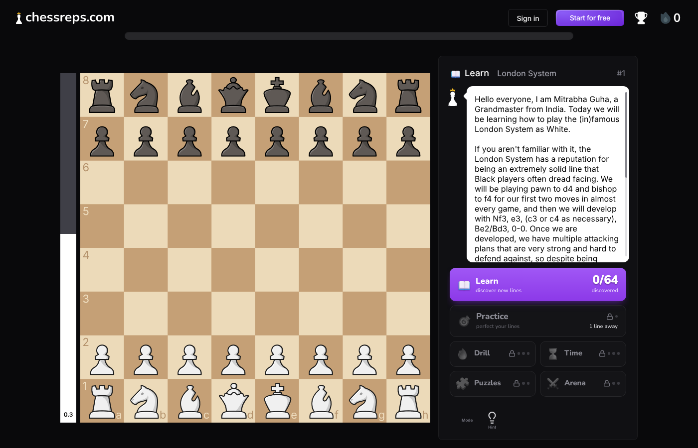

# Opening Gym

A free, open-source, **local-first chess opening trainer**. Learn each opening line move by move with
plain-English explanations, then drill it with spaced repetition. No account, no backend, no tracking:
progress lives in your browser and works offline.

<!-- Screenshots: replace the placeholders after the first public deploy.




-->
*(screenshots coming soon: `screenshots/` holds research captures of the product this project is an alternative to; app screenshots will be added here)*

## Features

- **24 opening courses** for White, Black and the classic traps, each with an SEO-friendly article (pros, cons, variations, FAQ).
- **Coach bubble** explaining the idea behind each move.
- **Five modes**: Learn (hints and notes), Practice (no hints, due and weak lines first), Drill (a streak that ends on one mistake), Time (60 seconds, clock speeds up) and Dojo (every course you have started, mixed).
- **Spaced repetition** with FSRS ([ts-fsrs](https://github.com/open-spaced-repetition/ts-fsrs)), daily streak, best scores and a 12-week **activity heatmap**.
- **Offline first**: a service worker precaches the whole app after the first visit. New deploys show a "New version available" toast.
- **Analysis board** with Stockfish running in your browser, a **game checker** that compares your games with your prep, and a **course creator**.
- **Your data stays yours**: IndexedDB storage with JSON export and import.
- Dark and light themes, mobile first (works at 360 px), keyboard and screen-reader friendly.
- Static site: host it anywhere for $0.

## Run it

Requires Node 22 or newer.

```bash
npm ci                 # at the repo root: gives scripts/validate.js its chess.js
cd web
npm ci
npm run dev            # http://localhost:5173
```

Useful commands (all in `web/`):

| Command | What it does |
|---|---|
| `npm run dev` | Dev server with hot reload (the service worker is only active in production builds) |
| `npm test` | Unit tests (Vitest) |
| `npx tsc -b` | Type-check |
| `npm run data` | Validate `data/courses.js` and regenerate `web/src/data/courses.json` |
| `npm run build` | Type-check, build, then prerender every page and write `sitemap.xml` and `robots.txt` |
| `npm run preview` | Serve the production build (`http://localhost:4173`). **Start it after the build**: it indexes `dist/` when it starts |
| `npm run e2e` | End-to-end smoke test against a running preview. Needs Playwright (see below) |
| `npm run icons` | Regenerate the PNG icons in `web/public/icons/` from `web/public/favicon.svg` |

### End-to-end tests

`web/e2e/smoke.mjs` drives a real browser against a **running production preview**. It plays lines by
clicking the board, checks progress persistence and the heatmap, renders `/analysis`, `/check` and `/create`
without console errors, checks `sitemap.xml` and the prerendered SEO tags, and reloads the main pages
**offline** (it also learns a line offline).

```bash
cd web
npm run build
npx vite preview --port 4173 &     # start it after the build
npm run e2e                        # BASE_URL=http://localhost:4173 by default
```

Playwright is not a dependency of the app. The scripts use a local `playwright` if there is one, or a global
install (`npm i -g playwright && playwright install chromium`).

## How course data works

```
data/courses.js          the source of truth: moves, notes and articles, written by hand
data/*.tsv               Lichess chess-openings (CC0): names and ECO codes for every position
scripts/validate.js      checks every course, writes dist/courses.json and web/src/data/courses.json
web/src/data/courses.json  GENERATED. Never edit it by hand
```

Each course is an object with `id`, `title`, `side` (`white`, `black` or `both`), `level`, `eco`, `summary`,
`ideas`, `style`, an `article` and `lines`. A line is a list of SAN moves plus notes keyed by move label
(`"5.c3"` for White, `"5...d6"` for Black):

```js
{
  name: "Giuoco Pianissimo: main plan",
  moves: "1.e4 e5 2.Nf3 Nc6 3.Bc4 Bc5 4.c3 Nf6 5.d3 d6 6.O-O a6 7.a4",
  notes: { "4.c3": "Prepares d4 one day and gives the bishop a retreat." },
}
```

Line kinds: `main` (the repertoire, default), `alternative` (a second option) and `warning` (a mistake to avoid,
shown in Learn only). The validator checks that every move is legal, every note label points at a real move,
the course gives one answer per position for the side it trains, and the article fields are well formed.

### Add a course

1. Add an object to the array in `data/courses.js` (copy a short existing course as a template).
2. Run `npm run validate` at the repo root (or `npm run data` in `web/`) and fix every error it prints.
3. Run `npm test` and `npm run build` in `web/`. The new course appears in the catalogue, gets its own
   `/opening/<id>` page, is prerendered and is added to `sitemap.xml` automatically.

Users can also build private courses in the app (`/create`); those live only in their browser.

## Deploy

The build output is a static folder, `web/dist`. Each run of `npm run build` also produces:
`shell.html` (the clean app shell used as the SPA fallback), one prerendered `index.html` per route,
`sitemap.xml`, `robots.txt` and `sw.js` with the offline precache list filled in.

Environment variables (all optional):

| Variable | Default | Meaning |
|---|---|---|
| `SITE_URL` | `https://example.com` | Public origin, used for canonical and Open Graph URLs, `sitemap.xml` and `robots.txt`. **Set this for a real deployment** |
| `BASE_PATH` | `/` | Sub-path the site is served from, e.g. `/opening-gym/` for a GitHub Pages project site. Becomes Vite's `base` |
| `SKIP_PRERENDER` | unset | `1` skips rendering the pages in a browser (the sitemap and robots files are still written) |
| `PRERENDER_STRICT` | unset | `1` makes a failed prerender fail the build (default: warn and ship the plain SPA). CI sets it |
| `OUT_DIR` | `dist` | Build output directory, relative to `web/` |

Prerendering needs Playwright and Chromium at build time. Without them the build still succeeds and ships the
plain single-page app.

### GitHub Pages

`.github/workflows/deploy.yml` installs, validates the course data, type-checks, tests, builds (with
`BASE_PATH=/<repo>/` and `SITE_URL=https://<owner>.github.io`), runs the e2e smoke test, copies `shell.html`
to `404.html` for deep links, and deploys `web/dist`. In the repository settings choose **Pages > Source:
GitHub Actions**. For a custom domain or a root site, set the repository variables `SITE_URL` and `BASE_PATH=/`.

### Netlify, Vercel, Cloudflare Pages

- **Netlify**: `web/netlify.toml` has the build command, the SPA rewrite and cache headers. Set `SITE_URL`.
- **Vercel**: `web/vercel.json` does the same. Set the project root to `web` and add `SITE_URL`.
- **Cloudflare Pages**: root directory `web`, build command `npm ci && npm run build`, output `dist`. `public/_redirects` and `public/_headers` are picked up from the build output.

All of them serve hashed files under `/assets/` with `immutable` caching and `sw.js`, `index.html` and
`shell.html` with `no-cache`, so a new deploy reaches users quickly.

## How offline works

`web/public/sw.js` is a small hand-written service worker. At build time `web/vite.config.ts` writes the list of
every JS and CSS chunk, icon, the manifest and the course data (it is bundled in the JavaScript) into it, plus a
build id (a hash of those files). On install it caches all of them under `og-precache-<build id>`; on
activation it deletes caches of older builds. Navigations go to the network first (so crawlers and online users
get the prerendered page) and fall back to the cached shell when offline or slow. The Stockfish engine
(about 2 MB) is not precached; it is cached the first time the analysis board runs. When a new build is
installed, a toast offers to reload; the old version keeps running until the person agrees.

## Project layout

```
data/            course source and Lichess opening names
scripts/         course validator
web/src/         the app (Vite + React 19 + TypeScript)
web/scripts/     prerender.mjs (SEO), make-icons.mjs
web/e2e/         Playwright smoke test
web/public/      icons, manifest, service worker, engine/ (Stockfish)
ARCHITECTURE.md  team rules and module boundaries
REPORT.md        research behind the project
```

## Credits and licence

Code: [MIT](LICENSE). Third-party software, data and the piece set (CC BY-SA 3.0) are listed in
[NOTICE.md](NOTICE.md): chess.js, cm-chessboard, ts-fsrs, idb-keyval, React, React Router, Stockfish.js
(GPL-3.0, shipped as a separate program) and the Lichess chess-openings dataset (CC0).
